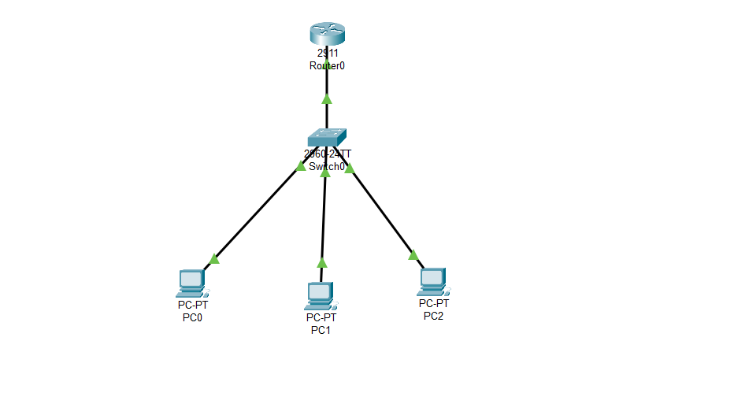
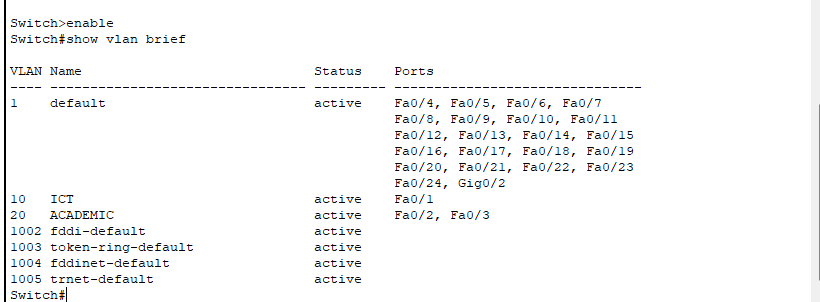
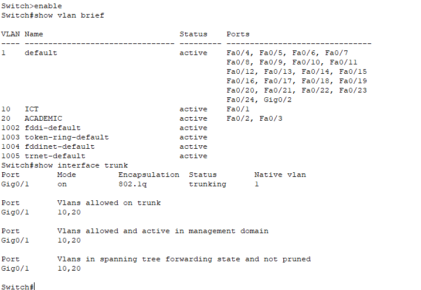
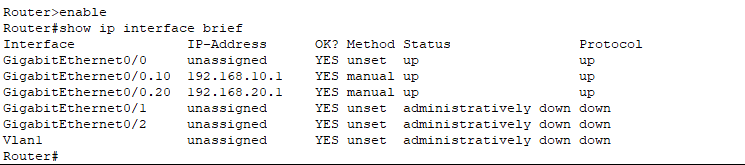
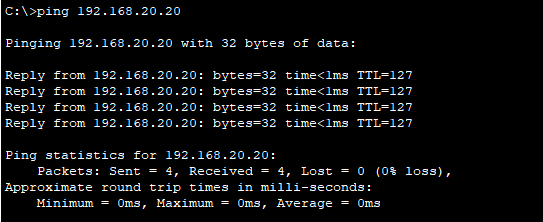
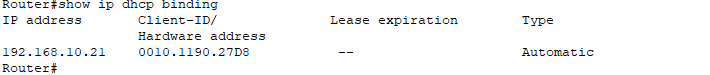
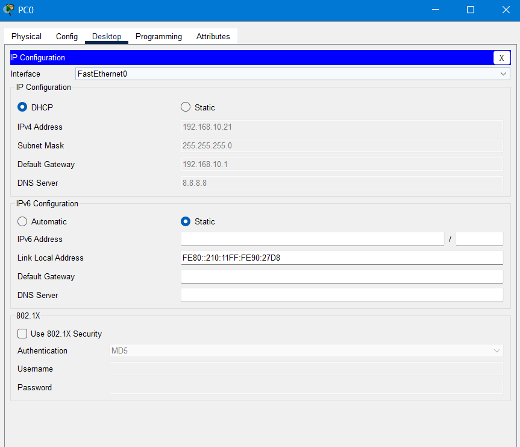

# Computer Networking Labs

**Hands-on Network Configuration and Troubleshooting Using Cisco Packet Tracer**

This repository documents my practical networking exercises, focusing on network configuration, VLAN segmentation, inter-VLAN routing, DHCP, and connectivity verification.

## Project Overview

This project simulates a small departmental network using Cisco Packet Tracer.

The network consists of:
- 1 Cisco 2911 Router
- 1 Cisco 2960 Switch
- 3 PCs

Two VLANs were configured to separate ICT and ACADEMIC departments. Router-on-a-Stick was implemented to enable communication between the VLANs.

## Network Topology

## Network Configuration

| Component | Configuration |
|---|---|
| VLAN 10 | ICT |
| VLAN 20 | ACADEMIC |
| VLAN 10 Network | 192.168.10.0/24 |
| VLAN 20 Network | 192.168.20.0/24 |
| VLAN 10 Gateway | 192.168.10.1 |
| VLAN 20 Gateway | 192.168.20.1 |
| Trunk Port | GigabitEthernet0/1 |
| Trunk Protocol | IEEE 802.1Q |

## VLAN Configuration

Two VLANs were created on the switch to separate departmental network traffic.

- VLAN 10 (ICT): FastEthernet0/1
- VLAN 20 (ACADEMIC): FastEthernet0/2 and FastEthernet0/3

The VLAN assignments were verified using the `show vlan brief` command.

## 802.1Q Trunking

GigabitEthernet0/1 was configured as a trunk port to carry traffic from VLAN 10 and VLAN 20.

The trunk configuration was verified using:

`show interfaces trunk`

## Inter-VLAN Routing

Router-on-a-Stick was implemented using two router subinterfaces.

| Router Subinterface | VLAN | IP Address |
|---|---|---|
| GigabitEthernet0/0.10 | 10 | 192.168.10.1/24 |
| GigabitEthernet0/0.20 | 20 | 192.168.20.1/24 |

Both subinterfaces were configured with IEEE 802.1Q encapsulation.

## Connectivity Testing

An ICMP ping test was performed from PC0 in VLAN 10 to PC2 in VLAN 20.

**Test Results:**

| Parameter | Result |
|---|---|
| Source | PC0 (VLAN 10) |
| Destination | PC2 (VLAN 20) |
| Destination IP | 192.168.20.20 |
| Packets Sent | 4 |
| Packets Received | 4 |
| Packet Loss | 0% |

The successful ping test confirmed inter-VLAN communication through Router-on-a-Stick.

## DHCP Configuration and Verification

DHCP was configured on the router to automatically assign IP addresses to clients in the 192.168.10.0/24 network.

PC0 successfully received the following network configuration:

| Parameter | Value |
|---|---|
| IPv4 Address | 192.168.10.21 |
| Subnet Mask | 255.255.255.0 |
| Default Gateway | 192.168.10.1 |
| DNS Server | 8.8.8.8 |
| IP Assignment | DHCP |

The DHCP lease was verified using the `show ip dhcp binding` command.

### DHCP Binding

### DHCP Client Configuration

## Tools and Technologies

- Cisco Packet Tracer
- Cisco IOS Command Line Interface (CLI)
- IPv4 Addressing and Subnetting
- Virtual Local Area Networks (VLANs)
- IEEE 802.1Q Trunking
- Router-on-a-Stick
- Dynamic Host Configuration Protocol (DHCP)
- ICMP Ping Testing

## Lab File

The Cisco Packet Tracer simulation file is available here:

[Download Training.pkt](Training.pkt)

## Learning Outcomes

Through these practical exercises, I gained experience in:

- Configuring and verifying VLANs on Cisco switches.
- Assigning switch ports to specific VLANs.
- Configuring IEEE 802.1Q trunk connections.
- Implementing Router-on-a-Stick for inter-VLAN routing.
- Configuring and verifying DHCP address allocation.
- Testing network connectivity using ICMP ping.
- Using Cisco IOS commands to verify and troubleshoot network configurations.

## Notes

This repository is intended for educational and portfolio purposes. All network configurations and tests were performed in a Cisco Packet Tracer simulation environment.
